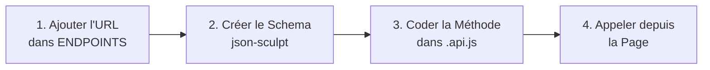

<div align="center">
  
  
  

  <h1>⚡ Skills WeChat PMT</h1>
  <p>Le Standard de Code pour WeChat Mini Program.<br/>Copie. Adapte. Livre.</p>
</div>

---

## En 1 Phrase

Ce kit te donne **le seul workflow à connaître** pour coder une interface WeChat et consommer une API de manière professionnelle, sans jamais créer de conflits Git avec ton équipe.

---

## 🚀 Démarrage Rapide

```bash
# Copie le cerveau IA dans ton projet
cp .cursorrules ./ton-projet/

# Copie les guides dans ton dossier docs
cp -r docs/ ./ton-projet/docs/
```

---

## 🛠️ Outillage CLI & Scripts npm

Des scripts Node.js et commandes npm automatisent le respect des standards sur votre poste ou en CI :

```bash
# 1. Scanner et valider l'intégrité du skill ou de votre mini-programme
# (Vérifie : 0 BOM UTF-8, syntaxe JSON, aucun nesting SCSS en WXSS, cohérence IA)
npm test                  # Lance l'audit complet (5 tests de santé + 3 tests générateurs)

# 2. Générer instantanément une page complète (Règle des 4 fichiers)
# Crée : index.js (State Machine), index.wxml (Safe Area & Shimmer), index.wxss (BEM Apple Press), index.json
node scripts/create-page.js pages/ma-nouvelle-page
# Optionnel : pré-câbler l'appel API avec BackendAPI
node scripts/create-page.js pages/mon-panier --with-api
# Dans un sous-paquet TCMPP (pour respecter la limite de 2 Mo du root) :
node scripts/create-page.js flight-detail --subpackage booking --with-api

# 3. Générer un composant réutilisable (Component, lifetimes, triggerEvent, BEM)
# Mode UI Présentation :
node scripts/create-component.js components/ui/product-card
# Mode UX / Skeletons Shimmer Wave & Empty State :
node scripts/create-component.js components/ux/order-skeleton --ux

# 4. Générer un module API & son Mappeur json-sculpt
# Crée : utils/apis/commande.api.js et utils/mappers/commande.js
node scripts/create-api.js commande
```

---

## 🗺️ Cartographie Complète : Les 5 Pôles de Compétences

Toutes les compétences du kit sont organisées en **5 pôles d'excellence**, couvrant 100 % des besoins d'un mini-programme professionnel :

```
                                  SKILLS WECHAT PMT
                                         │
    ┌──────────────┬─────────────────────┼─────────────────────┬──────────────┐
    ▼              ▼                     ▼                     ▼              ▼
┌───────────┐ ┌───────────┐       ┌───────────┐       ┌───────────┐ ┌───────────┐
│  PÔLE 1   │ │  PÔLE 2   │       │  PÔLE 3   │       │  PÔLE 4   │ │  PÔLE 5   │
│   UI/UX   │ │  LOGIQUE  │       │  API/DATA │       │  MAX IT   │ │  PROD/GIT │
│ Skeletons │ │  Routage  │       │  Mappers  │       │ Paiement  │ │ Compilate.│
│Animation  │ │ Behaviors │       │  OAuth2   │       │ Sécurité  │ │ Isolation │
└───────────┘ └───────────┘       └───────────┘       └───────────┘ └───────────┘

```

### 🎨 PÔLE 1 : UI, Skeletons Shimmer, Animations & Responsive
* 💀 **[`DOC_SKELETONS_ET_ETATS_UX.md`](docs/DOC_SKELETONS_ET_ETATS_UX.md)** : Skeletons shimmer wave (.shimmer à 60 FPS), cartes fantômes, empty states, error fallbacks, isolation `components/ux/`.
* 📱 **[`DOC_RESPONSIVE_IPHONE_ET_CUSTOM_TABBAR.md`](docs/DOC_RESPONSIVE_IPHONE_ET_CUSTOM_TABBAR.md)** : Responsive iPhone physique, Safe Areas (`env(safe-area-inset-bottom)`), capsule WeChat et Custom TabBar officiel sans scintillement.
* 🌙 **[`DOC_DARK_MODE_ET_ACCESSIBILITE.md`](docs/DOC_DARK_MODE_ET_ACCESSIBILITE.md)** : Support du mode sombre natif WeChat (`theme.json`), variables CSS adaptatives et contrastes WCAG AA.
* 🎬 **[`DOC_FLUX_COMPLEXES_ANIMATIONS.md`](docs/DOC_FLUX_COMPLEXES_ANIMATIONS.md)** : Feedback tactile au toucher (`hover-class="btn--pressed"` Apple Press), entrée de page fluide et séquences JS (`wx.createAnimation`).
* 🎨 **[`DOC_UI_POUR_DEVELOPPEURS.md`](docs/DOC_UI_POUR_DEVELOPPEURS.md)** : La règle des 4 fichiers, machine à états (`uiState`), mise en page BEM et formatage WXS pur ES5.

### 🧠 PÔLE 2 : Logique Métier, Navigation & Behaviors
* 🚀 **[`DOC_PATTERNS_AVANCES_ATS.md`](docs/DOC_PATTERNS_AVANCES_ATS.md)** : Analyse exhaustive page par page (9 pages), machine à états, boucliers réseau, tarification par paliers et cache SWR.
* 🧭 **[`DOC_NAVIGATION_BEHAVIORS_ET_METIER.md`](docs/DOC_NAVIGATION_BEHAVIORS_ET_METIER.md)** : Protection contre le crash de la pile à 10 pages (`navigateToSafe`), anti-double clic (`withLock`), retour intelligent.
* 🧩 **WeChat Behaviors Natifs** : Partage d'état et de chargement sans héritage (`loadingBehavior` avec `withLoading`).
* 📊 **Calculs Métier & Favoris** : Barèmes d'annulation/pénalités par paliers de dates, et favoris optimistes bi-niveaux (mémoire 0ms + stockage local).
* 🚌 **[`DOC_COMMUNICATION_EVENEMENTS.md`](docs/DOC_COMMUNICATION_EVENEMENTS.md)** : Quand utiliser `this.triggerEvent`, `Bus.emit` ou `Bus.setState`.

### 🔌 PÔLE 3 : Consommation API & Gestion des Données
* 🔌 **[`DOC_API_POUR_DEVELOPPEURS.md`](docs/DOC_API_POUR_DEVELOPPEURS.md)** : Le workflow strict en 4 étapes (Endpoint -> json-sculpt schema -> Méthode BackendAPI -> Appel Page).
* 🛡️ **OAuth2 & Buffer de Sécurité** : Renouvellement automatique avec marge de 60s (`REFRESH_BUFFER_MS`) pour éliminer tout rejet 401.
* 🗄️ **Mappers & Formatters** : Isolation totale de la donnée brute avec `json-sculpt` et formateurs de prix multi-devises (XOF, FCFA, EUR).

### ⚙️ PÔLE 4 : Intégration Hôte Max It, Paiement & Sécurité
* 📱 **[`DOC_MAXIT_MINI_SDK_SONATEL.md`](docs/DOC_MAXIT_MINI_SDK_SONATEL.md)** : Guide officiel du SDK Sonatel (`@sonatel-os/maxit-mini-sdk`), identité sans écran de login (`user()`), contacts, scan caméra seule anti-fraude et simulation sous DevTools.
* 💳 **[`DOC_PAIEMENT_NATIVE_MAXIT_ET_RESILIENCE.md`](docs/DOC_PAIEMENT_NATIVE_MAXIT_ET_RESILIENCE.md)** : Bouclier bancaire (`_confirmedTxnid`) garantissant 0 % de double débit, Smart Polling 4G à 3 essais et gestion des erreurs incertaines (`err.uncertain`).
* 🛡️ **[`DOC_HOMOLOGATION_ET_SECURITE_SONATEL.md`](docs/DOC_HOMOLOGATION_ET_SECURITE_SONATEL.md)** : Grille des 10 portes d'homologation, conformité CDP Sénégal (masquage MSISDN `77 *** ** 12`), purge de session et whitelist domaines TCMPP.
* 🛡️ **Sécurité Écran** : Verrouillage anti-capture d'écran sur les billets QR (`screen.protect(true)` puis obligatoirement `protect(false)`).
* 📊 **[`DOC_TAGGAGE_EVENEMENTS_ET_ANALYTICS.md`](docs/DOC_TAGGAGE_EVENEMENTS_ET_ANALYTICS.md)** : Télémétrie et suivi des conversions conforme Orange/Sonatel avec file d'attente hors-ligne.

### 🛠️ PÔLE 5 : Compilateur TCMPP & Qualité d'Équipe
* 📦 **[`DOC_ARCHITECTURE_SUBPACKAGES_TCMPP.md`](docs/DOC_ARCHITECTURE_SUBPACKAGES_TCMPP.md)** : Règle des 2 Mo, découpage en sous-paquets, préchargement `preloadRule` et option `--subpackage`.
* 🛠️ **[`DOC_PIEGES_COMPILATEUR_ET_PATTERNS_PROD.md`](docs/DOC_PIEGES_COMPILATEUR_ET_PATTERNS_PROD.md)** : Résolution des erreurs fatales du compilateur (BOM UTF-8, erreur 404 sur les polices locales `@font-face`, clauses de garde dans `onLoad`).
* 🤝 **Matrice d'Isolation Multi-Développeurs** : Attribution exclusive des dossiers pour faire collaborer 7 développeurs en simultané avec zéro conflit Git.
* 📚 **[`DOC_RECETTES_COPIER_COLLER.md`](docs/DOC_RECETTES_COPIER_COLLER.md)** : 47 recettes de code complètes prêtes à copier.
* 🎛️ **[`DOC_GUIDE_DECLENCHEURS_IA.md`](docs/DOC_GUIDE_DECLENCHEURS_IA.md)** : Guide pratique complet des 14 déclencheurs maîtres IA avec cas d'usage et codes associés.
* 🩺 **`skill-doctor.js`** : Outil d'audit automatique (zéro BOM UTF-8, syntaxe JSON, aucun nesting SCSS en WXSS, déclencheurs IA).
* ⚡ **`create-page.js`** : Générateur de page boilerplate WeChat conforme (4 fichiers : .js, .wxml, .wxss, .json).
* 🧩 **`create-component.js`** : Générateur de composant conforme (UI présentation ou UX skeleton shimmer avec `options: { addGlobalClass: true }`).
* 🔌 **`create-api.js`** : Générateur de service API et schéma de données json-sculpt.
* 🤖 **CI GitHub Actions** : `.github/workflows/ci.yml` pour valider automatiquement la conformité et zéro BOM sur chaque push.
* ❓ **[`DOC_FAQ_ERREURS_FREQUENTES.md`](docs/DOC_FAQ_ERREURS_FREQUENTES.md)** : 40+ questions/réponses de production.

## 📐 Partie 1 — Créer une Interface UI

### La Règle des 4 Fichiers

Chaque page ou composant = 4 fichiers dans son propre dossier. **On ne touche jamais les fichiers des autres.**

```
pages/ma-page/
  ├── index.js      ← La logique
  ├── index.wxml    ← Le visuel (HTML)
  ├── index.wxss    ← Le style (CSS)
  └── index.json    ← La config
```

---

### La Règle des États (State Machine)

Au lieu de coder dans le vide, tu définis **tous tes écrans** dans une seule variable `uiState`. Tu peux tester n'importe quel écran en changeant juste un mot.

**`index.js`**
```javascript
Page({
  data: {
    // Changer cette valeur pour voir n'importe quel écran instantanément
    // Valeurs : 'loading' | 'content' | 'empty' | 'error'
    uiState: 'content',

    // Tes fausses données (mock). Copie la forme exacte du JSON du backend.
    user: {
      name: "Malick Dev",
      balance: 25000,
      isPremium: true
    }
  }
});
```

**`index.wxml`**
```xml
<!-- Import du formateur de données (OBLIGATOIRE) -->
<wxs src="../../utils/wxs/filters.wxs" module="f" />

<!-- État : Chargement -->
<view wx:if="{{uiState === 'loading'}}" class="skeleton" />

<!-- État : Contenu -->
<view wx:elif="{{uiState === 'content'}}" class="container animate-fade-in">
  <text class="name">{{ user.name }}</text>

  <!-- On formate TOUJOURS avec WXS, jamais dans le JS -->
  <text class="balance">{{ f.formatPrice(user.balance) }}</text>
</view>

<!-- État : Vide -->
<view wx:elif="{{uiState === 'empty'}}">
  <text>Aucune donnée disponible</text>
</view>

<!-- État : Erreur -->
<view wx:elif="{{uiState === 'error'}}">
  <text>Une erreur est survenue. Réessaie.</text>
</view>
```

---

### Les Animations (Copier-Coller dans `app.wxss`)

```css
/* Fondu — Pour les pages et listes */
.animate-fade-in { animation: fadeIn 0.3s ease-out forwards; }
@keyframes fadeIn { from { opacity: 0; } to { opacity: 1; } }

/* Glissement depuis le bas — Pour les pop-ups et tiroirs */
.animate-slide-up { animation: slideUp 0.4s cubic-bezier(0.16, 1, 0.3, 1) forwards; }
@keyframes slideUp {
  from { transform: translateY(100%); opacity: 0; }
  to { transform: translateY(0); opacity: 1; }
}

/* Protection iPhone — Sur TOUTES les barres fixes en bas */
.safe-bottom { padding-bottom: env(safe-area-inset-bottom); }
```

---

### Page vs Composant — Ne jamais confondre

| | Page `pages/` | Composant `components/` |
|---|---|---|
| Cycle de vie | `onLoad()` `onShow()` | `lifetimes: { attached() {} }` |
| Parler au parent | _(c'est la racine)_ | `this.triggerEvent('action', data)` |
| Données globales | `Bus.setState('cle', data)` | `Bus.onState('cle', callback)` |

---

## 🔌 Partie 2 — Consommer une API

### Le Flux en 4 Étapes (Toujours dans cet ordre)



---

### Étape 1 — L'URL (`utils/apis/index.js`)
```javascript
const ENDPOINTS = {
  GET_USER: '/api/v1/users/me',       // ← Ajoute ton URL ici
  CREATE_ORDER: '/api/v1/orders'
};
```

---

### Étape 2 — Le Schema Mappeur (`utils/mappers/user.js`)

Le schema protège ton UI des changements du backend. Si le backend renomme un champ, tu changes juste ici.

```javascript
export const UserSchema = {
  id:        "@link.user_id",                          // Valeur simple
  fullName:  (d) => `${d.first_name} ${d.last_name}`, // Calcul personnalisé
  balance:   "@link.wallet.amount::number",            // Forçage de type
  isPremium: "@link.subscription.active::boolean"      // Vrai/Faux
};
```

---

### Étape 3 — La Méthode (`utils/apis/user.api.js`)

```javascript
import { httpClient } from './http.js';
import { authenticate } from './auth.js';
import { sculpt } from '../json-sculpt/sculpt.js';
import { UserSchema } from '../mappers/user.js';

class UserAPI {

  // GET — Récupérer une donnée
  async getProfile() {
    await authenticate();                                    // Gère le token auto
    const res = await httpClient.get(ENDPOINTS.GET_USER);

    if (!res.success) throw new Error(res.error?.message);  // Gestion d'erreur

    return sculpt.data({ data: res.data, to: UserSchema }); // Données propres
  }

  // POST — Envoyer une donnée
  async createOrder(payload) {
    await authenticate();
    const res = await httpClient.post(ENDPOINTS.CREATE_ORDER, payload);

    if (!res.success) throw new Error(res.error?.message);
    return res.data;
  }
}

export const userAPI = new UserAPI();
```

Puis déclare-le dans le hub (`utils/apis/index.js`) :
```javascript
export { userAPI } from './user.api.js';
```

---

### Étape 4 — L'Appel dans la Page

```javascript
import { userAPI } from '../../utils/apis/index.js';

Page({
  data: { uiState: 'loading', user: null },

  async onLoad() {
    try {
      const user = await userAPI.getProfile();
      this.setData({ user, uiState: 'content' });
    } catch (error) {
      this.setData({ uiState: 'error' });
      wx.showToast({ title: error.message, icon: 'none' });
    }
  }
});
```

---

## 🤖 Pilote l'IA avec ces 3 Mots

Si tu utilises Cursor, Copilot ou Gemini avec le fichier `.cursorrules` :

| Tape dans ton prompt | L'IA fait quoi |
|---|---|
| `@UI-MOCK` | Construit le design complet avec de fausses données. Pas de réseau. |
| `@API-CONNECT` | Connecte une page existante à son endpoint API. |
| `@FULL-FEATURE` | Fait le design ET l'API en une seule fois. |

---

## ❌ Les Erreurs Interdites

| Interdit | Pourquoi | Bonne pratique |
|---|---|---|
| `wx.request()` direct | Contourne la sécurité | Utiliser `httpClient` |
| `onLoad()` dans un Component | Crash silencieux | `lifetimes: { attached() {} }` |
| `const` dans un `.wxs` | Erreur de syntaxe WeChat | Utiliser `var` (ES5 seulement) |
| Texte en dur dans le WXML | App non-traduisible | Utiliser les clés `i18n` |
| `Bus.emit()` entre composants proches | Couplage invisible | `this.triggerEvent()` |
| `Promise.race` 30s sur `merchantPay` | Débit fantôme (Ghost Debit) | Laisser le SDK natif gérer le cycle PIN |
| Bouton fixé sans Safe Area | Masqué par Home Indicator iPhone | `padding-bottom: calc(XXrpx + env(safe-area-inset-bottom))` |
| `height: 100vh; overflow: hidden` | Contenu tronqué sur iPhone réel | Préférer `min-height: 100vh` souple |
| Oublier `getTabBar().setData()` dans `onShow` | Mauvais onglet actif / scintillement | Synchroniser l'index dans le cycle `onShow` |

---

<div align="center">
  <i>Lisez une fois. Appliquez toujours.</i>
</div>

- 💳 **`DOC_PAIEMENT_NATIVE_MAXIT_ET_RESILIENCE.md`** : Architecture complète paiement marchand Max It / TCMPP, bouclier anti-double débit (`_confirmedTxnid`), Smart Polling 4G et récupération hors-ligne.
- 📱 **`DOC_RESPONSIVE_IPHONE_ET_CUSTOM_TABBAR.md`** : Rendu iPhone réel, Safe Areas, calcul de capsule WeChat et architecture officielle Custom TabBar.
- 📱 **`DOC_MAXIT_MINI_SDK_SONATEL.md`** : Guide officiel du SDK Sonatel Max It (`@sonatel-os/maxit-mini-sdk`), pièges hôte résolus, identité, paiement OM, contacts, scan anti-fraude, protection d'écran et DevTools fixtures.
- 🧭 **`DOC_NAVIGATION_BEHAVIORS_ET_METIER.md`** : Navigation sécurisée (pile 10 pages, anti-double clic), mixins officiels WeChat (Behaviors) et règles métier (annulation, favoris, buffer OAuth2).
- 🛠️ **`DOC_PIEGES_COMPILATEUR_ET_PATTERNS_PROD.md`** : Résolution des pièges fatals TCMPP (BOM UTF-8, @font-face 404, guards onLoad, retour intelligent, matrice d'isolation à 7 développeurs).
- 🎬 **`DOC_FLUX_COMPLEXES_ANIMATIONS.md`** : Feedback tactile au clic (`hover-class` Apple Press), entrée de page fluide 60 FPS, micro-interactions (cœur pulsant) et séquences JS (`wx.createAnimation`).
- 📚 **`DOC_RECETTES_COPIER_COLLER.md`** : 47 recettes prêtes à l'emploi (Liste, Formulaire, Upload, Paiement natif, Smart polling, Custom navbar, Custom tabbar, Store réactif, Navigation safe, Behaviors, SDK officiel Max It, Guards onLoad, Retour intelligent, withLock, handleAppError, Feedback tactile, Entrée de page, Séquence de succès).
- ❓ **`DOC_FAQ_ERREURS_FREQUENTES.md`** : 40+ questions/réponses pour ne jamais faire d'erreur (UI, API, Paiement, iPhone, Git, Performance).
