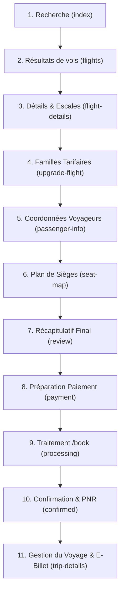

> 🧭 **Navigation :** [UI](DOC_UI_POUR_DEVELOPPEURS.md) | [API](DOC_API_POUR_DEVELOPPEURS.md) | [SDK Max It Sonatel](DOC_MAXIT_MINI_SDK_SONATEL.md) | [Paiement & Résilience](DOC_PAIEMENT_NATIVE_MAXIT_ET_RESILIENCE.md) | [Responsive & TabBar](DOC_RESPONSIVE_IPHONE_ET_CUSTOM_TABBAR.md) | [Navigation & Behaviors](DOC_NAVIGATION_BEHAVIORS_ET_METIER.md) | [Tunnels & Billetterie](DOC_TUNNELS_METIERS_ET_BILLETTERIE_AVANCEE.md) | [Recettes](DOC_RECETTES_COPIER_COLLER.md) | [Données](DOC_DONNEES_MAPPERS_HELPERS.md) | [FAQ](DOC_FAQ_ERREURS_FREQUENTES.md)

---

# ✈️ Tunnels Métiers Complexes, Billetterie & Rendu Haute Performance TCMPP

> **Origine industrielle :** Issu des retours d'expérience et des patterns validés sur le projet de référence **FlyAfriTrip** (94/94 tests unitaires et d'intégration validés).  
> Ce document formalise les solutions d'ingénierie indispensables pour concevoir des parcours de réservation multi-écrans (aérien, ferroviaire, bus, billetterie événementielle) sur WeChat et TCMPP sans perte d'état, sans saturation du pont IPC et sans dépasser le quota des 2 Mo.

---

## 📑 Sommaire

1. [🏛️ Architecture d'un Entonnoir de Réservation en 11 Écrans](#1-architecture-dun-entonnoir-de-réservation-en-11-écrans)
2. [📄 Générateur de Billet/Facture PDF Vectoriel Natif (0 Kilo-octet de dépendance)](#2-générateur-de-billetfacture-pdf-vectoriel-natif-0-kilo-octet-de-dépendance)
3. [💺 Plan de Sièges Interactif & Encodage Standard GDS (15 Champs)](#3-plan-de-sièges-interactif--encodage-standard-gds-15-champs)
4. [⚡ Rendu par Lots Anti-Freeze IPC (Batch Rendering 20 Cartes)](#4-rendu-par-lots-anti-freeze-ipc-batch-rendering-20-cartes)
5. [💰 Moteur de Décomposition Tarifaire Résilient (Price Breakdown Shield)](#5-moteur-de-décomposition-tarifaire-résilient-price-breakdown-shield)
6. [🔒 Protection Anti-Double Soumission en Mémoire (`attemptId`)](#6-protection-anti-double-soumission-en-mémoire-attemptid)

---

## 1. Architecture d'un Entonnoir de Réservation en 11 Écrans

Un tunnel de réservation complet implique une séquence d'étapes où chaque écran affine et enrichit le contrat de données :



### Les 4 Niveaux d'Étanchéité des Données

Pour éviter qu'une action dans un écran ne vienne corrompre un autre écran, les données sont réparties en 4 niveaux stricts :

| Niveau | Emplacement | Durée de Vie | Usage |
|---|---|---|---|
| **1. Mémoire Locale** | `this.state` dans la page JS | Vie de l'écran actif | Objets bruts fournisseurs volumineux, promesses en vol, calculs intermédiaires. |
| **2. Modèle de Vue WXML** | `this.data` via `setData` | Rendu de la vue | Uniquement les champs formatés nécessaires aux balises `{{ ... }}`. |
| **3. Contexte Partagé** | `EventBus` en mémoire vive | Session de l'application | Contrats de passage d'écran à écran (`booking.payload`, `seat.selection`, etc.). |
| **4. Stockage Persistant** | `storage.set` | Survit au redémarrage | Dossiers de réservations confirmées, jetons de session, préférences client. |

### Le Pattern `checkoutSnapshot` : Sceller le Voyage Confirmé
Dès que la commande est confirmée par le serveur distant, la page `confirmed` génère un **instantané immuable** (`checkoutSnapshot`). Cet instantané associe la réservation aux identifiants exacts :
* `searchId` & `packageId`
* `bookingHashId` & PNR
* Nombre de passagers et composition de l'itinéraire

Si l'utilisateur clique sur "Retour" ou effectue une nouvelle recherche pour un autre voyage, les détails du voyage confirmé affichés sur `trip-details` restent **100% isolés et intouchés**.

---

## 2. Générateur de Billet/Facture PDF Vectoriel Natif (0 Kilo-octet de dépendance)

### 💡 Pourquoi les bibliothèques npm (`jspdf`, `pdfkit`) sont proscrites en TCMPP
1. **Surpoids fatal :** Une librairie comme `jspdf` pèse plus de 450 Ko, consommant 25% de la limite stricte de 2 Mo imposée par TCMPP.
2. **Incompatibilité DOM :** Ces librairies présupposent l'existence de `window`, `document` et des Canvas HTML5 classiques, inexistants dans le thread logique de WeChat.

### 🛠️ La Solution : Sérialisation Binaire Vectorielle Pure `%PDF-1.4`
Le fichier PDF est un document texte structuré selon la norme ISO. En générant les objets PDF natifs et la table de références croisées (`xref`) directement en JavaScript, on produit un véritable PDF vectoriel ultra-léger (environ 4 Ko) :

```javascript
// utils/helpers/pdfGenerator.js

/**
 * Sérialise une liste d'objets PDF en un document binaire standard %PDF-1.4
 * avec calcul dynamique de la table xref au caractère près.
 */
export function serializePdfObjects(objects) {
  let pdf = "%PDF-1.4\n";
  const offsets = [0];

  // 1. Écriture séquentielle des objets PDF
  objects.forEach((object, index) => {
    offsets.push(pdf.length);
    pdf += `${index + 1} 0 obj\n${object}\nendobj\n`;
  });

  // 2. Table des références croisées (XREF)
  const xref = pdf.length;
  pdf += `xref\n0 ${objects.length + 1}\n0000000000 65535 f \n`;

  offsets.slice(1).forEach((offset) => {
    pdf += `${String(offset).padStart(10, "0")} 00000 n \n`;
  });

  // 3. Trailer et signature finale
  pdf += `trailer\n<< /Size ${objects.length + 1} /Root 1 0 R >>\nstartxref\n${xref}\n%%EOF`;
  return pdf;
}

/**
 * Construit les objets d'un billet de transport / reçu de paiement
 */
export function buildTicketPdf({ reference, passengerName, route, date, amount, currency }) {
  // Page A4 standard : 595 x 842 points
  const pageContent = `
    BT
      /F1 20 Tf
      50 780 Td
      (BILLET DE TRANSPORT OFFICIEL) Tj
      /F1 12 Tf
      0 -30 Td
      (Reference : ${reference}) Tj
      0 -20 Td
      (Passager : ${passengerName}) Tj
      0 -20 Td
      (Trajet : ${route}) Tj
      0 -20 Td
      (Date : ${date}) Tj
      0 -30 Td
      /F1 14 Tf
      (Total Regle : ${amount} ${currency}) Tj
    ET
  `;

  const objects = [
    // 1. Catalogue racine
    "<< /Type /Catalog /Pages 2 0 R >>",
    // 2. Arbre des pages
    "<< /Type /Pages /Kids [3 0 R] /Count 1 >>",
    // 3. Définition de la page
    "<< /Type /Page /Parent 2 0 R /MediaBox [0 0 595 842] /Contents 4 0 R /Resources << /Font << /F1 5 0 R >> >> >>",
    // 4. Flux de contenu
    `<< /Length ${pageContent.trim().length} >>\nstream\n${pageContent.trim()}\nendstream`,
    // 5. Police standard Helvetica
    "<< /Type /Font /Subtype /Type1 /BaseFont /Helvetica >>"
  ];

  return serializePdfObjects(objects);
}

/**
 * Sauvegarde et ouverture native sur le smartphone
 */
export function exporterBilletPdf(ticketData) {
  return new Promise((resolve, reject) => {
    const pdfData = buildTicketPdf(ticketData);
    const fs = wx.getFileSystemManager();
    const filePath = `${wx.env.USER_DATA_PATH}/billet_${ticketData.reference}.pdf`;

    fs.writeFile({
      filePath,
      data: pdfData,
      encoding: 'binary',
      success: () => {
        // Ouvre la visionneuse PDF native du téléphone avec menu de partage (WhatsApp, Email, Impression)
        wx.openDocument({
          filePath,
          fileType: 'pdf',
          showMenu: true,
          success: resolve,
          fail: reject
        });
      },
      fail: reject
    });
  });
}
```

---

## 3. Plan de Sièges Interactif & Encodage Standard GDS (15 Champs)

### Modélisation de la Cabine
Un plan de cabine (avion ou autocar) associe un numéro de rangée et une lettre de colonne (`12A`, `12B`, etc.).

### Règle Métier Aérienne Stricte : Exclusion des Bébés sur les Genoux
Les nourrissons sur les genoux (`INL` / *Infant on Lap*) ne paient pas de siège physique. Le moteur doit refuser catégoriquement toute affectation de siège à cette catégorie de passager.

### Format de la Chaîne Encodée GDS (15 Champs Séparés par des Tirets)
Pour soumettre les sièges réservés à l'API de booking sans ambiguïté, la sélection de chaque siège est encodée selon le standard des GDS :

```text
départUnix-origine-destination-compagnie-numéroVol-indexVoyageur-siège-payant-total-base-taxe-devise-paysPOS-typeSiège-0
```

Exemple d'une chaîne valide :  
`1772438400-DSS-CDG-AF-719-1-14A-1-25000-25000-0-XOF-SN-WINDOW-0`

### Code de Validation & Sérialisation
```javascript
// utils/helpers/seatMap.js

/**
 * Valide et encode les sièges sélectionnés pour l'API de réservation
 */
export function encodeSeatSelections({ segments, travellers, selections, currency = 'XOF', posCountry = 'SN' }) {
  const result = {};
  let totalSeatPrice = 0;

  segments.forEach((segment, segmentIndex) => {
    const segmentSelections = selections[segment.id] || {};

    travellers.forEach((traveller, travellerIndex) => {
      // ⚠️ Exclusion stricte des bébés sur les genoux
      if (traveller.passengerType === 'INL') return;

      const seat = segmentSelections[traveller.id];
      if (!seat) return;

      const isPaid = (seat.price > 0) ? '1' : '0';
      const basePrice = seat.price || 0;
      const taxPrice = seat.tax || 0;
      totalSeatPrice += (basePrice + taxPrice);

      // Chaîne normalisée à 15 champs
      const encoded = [
        Math.floor(new Date(segment.departureDate).getTime() / 1000), // 1. timestamp unix
        segment.origin,                                               // 2. départ IATA
        segment.destination,                                          // 3. arrivée IATA
        segment.carrierCode,                                          // 4. compagnie
        segment.flightNumber,                                         // 5. numéro de vol
        travellerIndex + 1,                                           // 6. index passager (1-based)
        seat.code,                                                    // 7. siège (ex: 12A)
        isPaid,                                                       // 8. payant (1 ou 0)
        basePrice + taxPrice,                                         // 9. montant total
        basePrice,                                                    // 10. montant hors taxe
        taxPrice,                                                     // 11. taxe
        currency,                                                     // 12. devise
        posCountry,                                                   // 13. pays d'achat
        seat.type || 'STANDARD',                                      // 14. type de siège
        '0'                                                           // 15. réserve technique
      ].join('-');

      if (!result[segmentIndex]) result[segmentIndex] = [];
      result[segmentIndex].push(encoded);
    });
  });

  return {
    seatsConfirmed: Object.keys(result).length > 0 ? 1 : 0,
    seatSelections: result,
    totalSeatPrice
  };
}
```

---

## 4. Rendu par Lots Anti-Freeze IPC (Batch Rendering 20 Cartes)

### ⚠️ Le Goulot d'Étranglement WeChat / TCMPP
Dans les mini-programmes, le JavaScript s'exécute dans un thread isolé de la vue Web. Chaque appel à `this.setData()` sérialise les données en JSON et les envoie via un pont C++ natif (IPC).  
Lorsqu'une recherche renvoie 150 vols avec leurs segments, un appel unique `this.setData({ flights: allFlights })` peut faire transiter **2 à 3 Mo de JSON d'un coup**, provoquant :
* Un gel complet de l'interface tactile pendant 1 500 ms.
* Des pertes de frames (chute à 10 FPS).
* Le crash silencieux de l'application sur les téléphones Android d'entrée de gamme.

### 🚀 La Solution : Rendu en Cascade par Lots de 20 avec Callback
L'astuce consiste à conserver la totalité des données dans la mémoire JavaScript (`this.rawFlights`), et à n'envoyer à la vue que des tranches de 20 cartes en attendant que le callback natif de `setData` confirme que le premier paquet a été dessiné :

```javascript
// pages/flights/index.js

Page({
  data: {
    displayedFlights: [],
    isLoadingMore: false
  },

  // Stockage logique hors de setData (zéro surcharge IPC)
  rawFlights: [],
  batchSize: 20,
  currentIndex: 0,

  initFlightResults(flightsList) {
    this.rawFlights = flightsList;
    this.currentIndex = 0;
    this.setData({ displayedFlights: [] }, () => {
      // Démarre l'injection du premier lot
      this.injectNextBatch();
    });
  },

  injectNextBatch() {
    if (this.currentIndex >= this.rawFlights.length) {
      this.setData({ isLoadingMore: false });
      return;
    }

    const nextBatch = this.rawFlights.slice(
      this.currentIndex,
      this.currentIndex + this.batchSize
    );

    // Injection incrémentale optimisée
    const updatePayload = {};
    nextBatch.forEach((item, index) => {
      // Syntaxe de chemin direct : évite de renvoyer tout le tableau précédent !
      updatePayload[`displayedFlights[${this.currentIndex + index}]`] = item;
    });

    this.currentIndex += nextBatch.length;

    // Le callback garantit que le thread de vue a terminé avant de continuer
    this.setData(updatePayload, () => {
      // Si l'écran a de la marge ou lors du scroll bas, on injecte la suite
      if (this.currentIndex < 40) {
        this.injectNextBatch();
      }
    });
  },

  onReachBottom() {
    // Déclenché quand l'utilisateur fait défiler vers le bas
    this.injectNextBatch();
  }
});
```

---

## 5. Moteur de Décomposition Tarifaire Résilient (Price Breakdown Shield)

Un calcul de prix dans un tunnel d'achat de billets ne doit laisser aucune place à l'improvisation bancaire :

```
┌─────────────────────────────────────────────────────────┐
│               PRICE BREAKDOWN CONTRACT                  │
├─────────────────────────────────────────────────────────┤
│ (+) Base Tarifaire Adultes   (quantité × prix unitaire) │
│ (+) Base Tarifaire Enfants   (quantité × prix unitaire) │
│ (+) Taxes & Surcharges       (total package fournisseur)│
│ (+) Options Sièges           (somme des sièges choisis) │
│ (+) Bagages Additionnels     (extras validés)           │
│ (-) Remise Code Promotionnel (montant déduit)           │
│ ─────────────────────────────────────────────────────── │
│ (=) TOTAL NET À PAYER (doit concorder au centime près)  │
└─────────────────────────────────────────────────────────┘
```

### Les 4 Règles d'Or du Calculateur

1. **Absence de taxe ≠ Zéro Franc :** Si l'API renvoie `tax: null` ou `tax: undefined`, la taxe est **inconnue** (état d'attente d'enrichissement), elle ne doit jamais être transformée en `0 FCFA` par défaut.
2. **Bouclier anti-mismatch de devises :** Si un billet est coté en `EUR` et qu'une option arrive en `XOF`, lever immédiatement une erreur bloquante. Ne jamais additionner des chiffres issus de monnaies différentes.
3. **Protection contre la sur-multiplication des taxes :** Certaines API renvoient une taxe déjà agrégée pour l'ensemble du groupe. Multiplier cette taxe une seconde fois par le nombre de passagers créerait un montant surfacturé illégal.
4. **Précision entière du Franc CFA :** En zone UEMOA, arrondir à l'entier le plus proche (`Math.round(total)`).

```javascript
// utils/helpers/pricingShield.js

export function calculateValidatedPricing({ baseFares = [], packageTax, seatFees = 0, addOns = 0, discount = 0, currency = 'XOF' }) {
  // 1. Validation de la devise
  if (!currency || typeof currency !== 'string') {
    throw new Error('Devise invalide ou non spécifiée');
  }

  // 2. Calcul des bases passagers
  let totalBase = 0;
  baseFares.forEach(fare => {
    if (typeof fare.amount !== 'number' || fare.amount < 0) {
      throw new Error(`Tarif de base invalide pour la catégorie : ${fare.category}`);
    }
    totalBase += (fare.amount * (fare.count || 1));
  });

  // 3. Contrôle rigoureux de la taxe
  if (packageTax === null || packageTax === undefined) {
    return { isComplete: false, reason: 'TAX_PENDING_LOOKUP' };
  }

  // 4. Total net certifié
  const totalAmount = Math.max(0, Math.round(totalBase + packageTax + seatFees + addOns - discount));

  return {
    isComplete: true,
    currency,
    breakdown: {
      totalBase,
      packageTax,
      seatFees,
      addOns,
      discount,
      totalAmount
    }
  };
}
```

---

## 6. Protection Anti-Double Soumission en Mémoire (`attemptId`)

Sur mobile, la double pression involontaire ou les retentatives après micro-coupures 4G peuvent générer des doublons de réservation. Le pattern `attemptId` garantit qu'une seule requête réseau est exécutée pour une même tentative :

```javascript
// utils/apis/bookingGuard.js

// Table de promesses en mémoire vive
const activeBookingPromises = new Map();

/**
 * Exécute l'appel de booking en partageant la promesse active si l'attemptId existe déjà
 */
export function submitBookingOnce(attemptId, bookingPayload, apiCaller) {
  if (!attemptId) {
    throw new Error('attemptId obligatoire pour sécuriser la transaction');
  }

  // Si une requête pour cette tentative est déjà en cours, renvoyer la même promesse !
  if (activeBookingPromises.has(attemptId)) {
    console.warn(`[BookingGuard] Requête déjà en cours pour la tentative : ${attemptId}. Mutualisation.`);
    return activeBookingPromises.get(attemptId);
  }

  const promise = apiCaller(bookingPayload)
    .finally(() => {
      // Nettoyage après terminaison (succès ou échec)
      activeBookingPromises.delete(attemptId);
    });

  activeBookingPromises.set(attemptId, promise);
  return promise;
}
```

---

> 🔗 **Ressources complémentaires :**
> - [Guide Officiel du SDK Max It Sonatel](DOC_MAXIT_MINI_SDK_SONATEL.md)
> - [Matrice des Erreurs Production TCMPP & OM](DOC_MATRICE_ERREURS_PROD_TCMPP.md)
> - [Recettes Prêtes à l'Emploi](DOC_RECETTES_COPIER_COLLER.md)

